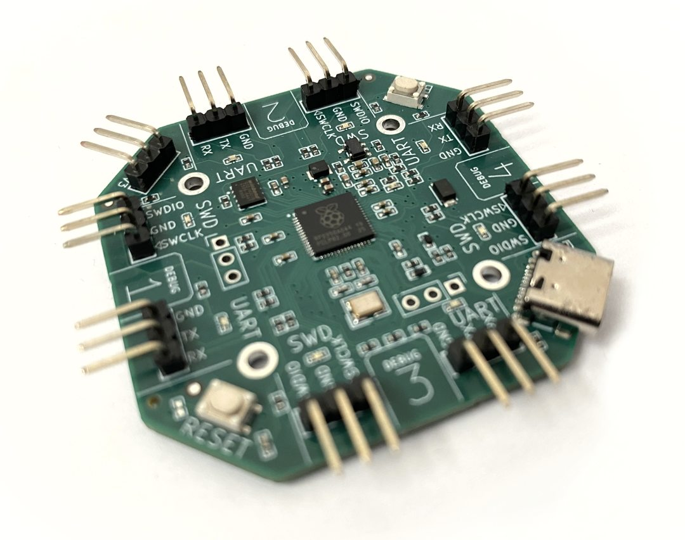

# MultiProbe Pico Debugger:lemon: # 
[](https://github.com/picolemon/multiprobe/blob/main/hw/multiprobe-pcb/doc/datasheet.pdf)
[](https://github.com/picolemon/picofabric-hardware/blob/main/hw/multiprobe-pcb/doc/multiprobe-pcb.pdf)
[](https://www.tindie.com/products/picolemon/multiprobe-pico-debugger/)




# Description
A development board to debug multiple pico devices based on the official debug probe ( https://github.com/raspberrypi/debugprobe ) which does the following:
- 4 active SWD ports, debug four targets at once using a single usb/device.
- Extra indicator LEDs displays which port is active.
- 4 UARTS multiplexed to 2 CDC Com ports.
- Supports RP2040 & RP2350 based boards.

## Compatibility
Tested on the following platforms:
- Ubuntu 22.04
- Mac mini mac OS Sequoia 15.6.1
- Windows 10 *(requires driver workaround using zadig)*


## Installation
Install VSCode and the official Raspberry Pi Pico extension ( https://marketplace.visualstudio.com/items?itemName=raspberry-pi.raspberry-pi-pico )


## SWD target
To set the debug target use the "cmsis-dap usb interface" OpenOCD command which can be set in the vscode launch.json
```
"cmsis-dap usb interface 0",            // Use DEBUG 1 port
"cmsis-dap usb interface 1",            // Use DEBUG 2 port
"cmsis-dap usb interface 2",            // Use DEBUG 3 port
"cmsis-dap usb interface 3",            // Use DEBUG 4 port
```

## Example configurations
To debug all four targets with dual UARTs add the following launch config section to each VSCode project. 
Only 2 projects can have an active UART due to the limited number of UARTs on the RP2350 and pin assignments.

Debug project 1 with UART on COM port ACM0:
```
"openOCDLaunchCommands": [    
    "adapter speed 5000",
    "cmsis-dap usb interface 0",            // Use DEBUG 1 port
    "init",                
    "cmsis-dap cmd 0x81",                   // Use UART1 on ACM0   ( HWUart0 )
]
```

Debug project 2 with UART on COM port ACM1:
```
"openOCDLaunchCommands": [    
    "adapter speed 5000",
    "cmsis-dap usb interface 1",            // Use DEBUG 2 port
    "init",                
    "cmsis-dap cmd 0x92",                   // Use UART2 on ACM1   ( HWUart1 )
]
```

Debug project 3 with no UART
```
"openOCDLaunchCommands": [    
    "adapter speed 5000",
    "cmsis-dap usb interface 2",            // Use DEBUG 3 port    
]
```

Debug project 4 with no UART
```
"openOCDLaunchCommands": [    
    "adapter speed 5000",
    "cmsis-dap usb interface 3",            // Use DEBUG 4 port    
]
```

## Uart setup
There are only 2 UART devices available so 2 of the four UARTs must be routed, this defaults to UART1 -> ACM0, and UART2 -> ACM1. 
There are also some limitation on which UARTs can be used together as the RP2350 has hard limits on which pins the UART can be assigned.
he hardware UART must be different so for example UART1 and UART3 cannot be used at the same time, in that case you will have to swap the ports.
Future versions will use a PIO based UART which resolves this restriction and/or having 4 CDC devices (see limitation).

The UARTs must be assigned to a com port using the table below:

```
UART (silkscreen)   OpenOCD code    UART Device     Hardware UART
UART1               0x81            ACM0            HWUart0
UART2               0x82            ACM0            HWUart1
UART3               0x83            ACM0            HWUart0
UART4               0x84            ACM0            HWUart1
                            
UART1               0x91            ACM1            HWUart0
UART2               0x92            ACM1            HWUart1
UART3               0x93            ACM1            HWUart0
UART4               0x94            ACM1            HWUart1
```

**Hint**: The vendor code is formatted so the first digit (8 for ACM0 or 9 for ACM1) corresponds to the COM port and the last digit (1,2,3 & 4) is the 
UART number printed on the board silkscreen.

For example if you plug a device into UART4 and want to communicated on ACM1 you would enter  "cmsis-dap cmd 0x94". Some limitation apply due to the 
pico hardware UART can only be assigned to certain pins, for example UART1 and UART3 can't be used at the same time as they share the same RP2550 hardware 
device. In the future a PIO based UART will be used to allow any gpio assignment.

The probe uses vendor codes to setup the UART must be called after the OpenOCD "init" using the following command sequence set in the launch.json:

```
"openOCDLaunchCommands": [    
    "adapter speed 5000",
    "cmsis-dap usb interface 0",            // Use DEBUG 1 port
    "init",                
    "cmsis-dap cmd 0x81",                   // Use UART3 on ACM1   ( HWUart0 )
]
```

## Windows compatibility
Windows is not currently supported out the box as some workarounds are needed to function.

To enable multiple debug multiple instances of openOCD the windows driver needs replacing as the built in WinUSB will only allow a single process to access the usb device.
A utility called zadig ( https://zadig.akeo.ie/ ) can replace the driver to allow multiple openOCD instances.

Warning: This can break your system if you select the wrong device, ensure the DAP device is selected before clicking the install button.
- Plug in the debugger into a USB port.
- download and run Zadig-2.9.exe from https://zadig.akeo.ie/ and click "Yes" on the UAC permission prompt.
- Go Options -> List All Devices
- The Device list will be populated and should have 4 CMSIS-DAP devices.
- Select "CMSIS-DAP v2 Interface (Interface 0)
- The driver input on the left should read "WinUSB", change the value on the right ( after the arrow ) to "libusbK" eg. WinUSB -> libusbK.
- Click "Install driver"
- Repeat for all 4 interfaces eg. "CMSIS-DAP v2 Interface (Interface 0), "CMSIS-DAP v2 Interface (Interface 1), "CMSIS-DAP v2 Interface (Interface 2) 
and "CMSIS-DAP v2 Interface (Interface 3)
- Reboot if needed


## Hacking
Open the project in VSCode using the "Raspberry Pi Pico" extension and compile.


## Changes from debugprobe
- VSCode based project
- hacked in multiple UARTs
- hacked in multiple port PIO DAP interfaces


## Testing
Connect a pico device to each port of the debug probe then open "testing/blink_iface0", "testing/blink_iface1", "testing/blink_iface2" and "testing/blink_iface3" 
in separate windows, Hit F5 to debug each to verify the openOCD debugger works in parallel. 


## Todo
- Fork official repo ( https://github.com/raspberrypi/debugprobe ) and make it easier to integrate upstream changes.
- PIO based UART to allow any gpio assignment and 4 active uarts without the vendor command routing.
- Resolve the 2 CDC device limit in usb descriptors/tinyusb configuration.


## Building your own
Any RP2040 or RP2350 device can be used, see multiprobe-pcb.kicad_sch for the gpio assignments or order a pcb from your favorite pcb supplier by submitting the 
hw/multiprobe-pcb/production/* files. A purchasable board is also available on tindie (https://www.tindie.com/products/picolemon/multiprobe-pico-debugger/).


### Support :zap:
- Email help@picolemon.com

Copyright (c) 2025 picoLemon
